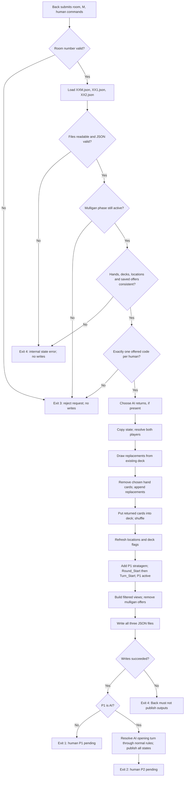

<!-- Modification 2026-10-07: Automatic AI now implemented; updated human-only input, prediction privacy and counter documentation. -->

<!-- Modification 2026-09-27: Created the initialization/mulligan flow sheet, failure behavior, and future effect integration notes. -->

# Motor flow sheet: initialization → mulligan → first turn

<!-- Modification 2026-09-27: Linked implemented passing/AFK/round flow and confirmed Back-owned zero-return mulligan timeout convention. -->

This sheet documents initialization and mulligans. I/M/P/T now support the vanilla PvP match loop, including passing, AFK and round outcomes; see [Turn flow](Turn-flow.md). AI turn decisions are automatic. Front and Back are assumed to meet their agreed responsibilities.

For mulligan AFK, Back supplies the timed-out seat's full offered zero-return code (`15000000000` for P1 or `25000000` for P2) with M and preserves the other submitted choice. Both humans may time out. T applies only during turns and is rejected during Mulligan; a bare 0 is not a complete M code.

<!-- Modification 2026-09-27: Updated the handoff from M to turn processing, stratagem location, command lists, and current verification scope. -->

## Back's command contract

Run these commands from the `motor` folder. Room files are always located beside `motor.py`, even when Back invokes it from another working directory.

| Situation | Command | Result |
| --- | --- | --- |
| Initialize two humans | `./motor.py 07 I P11 P22` | Exit `0`; initial `07M.json`, `071.json`, `072.json` |
| Both humans keep their hands | `./motor.py 07 M 15000000000 25000000` | Exit `1`; both hands retained; round 1 prepared |
| P1 human, P2 AI | `./motor.py 07 I P11 I21`, then `./motor.py 07 M 15000000000` | Motor selects P2's mulligan internally |
| P1 AI, P2 human | `./motor.py 07 I I11 P22`, then `./motor.py 07 M 25000000` | Motor selects P1's mulligan internally |

Back collects one command per **human** and sends them together in one `M` invocation. PvP requires two; AI games require one. The player prefix identifies the owner, so argument order does not matter. Do not send an AI code or placeholder. Back authenticates the sender and matches the sender to the player prefix; Motor has no account identity in this interface.

## Flow



For zero selected cards, the draw/return/shuffle operations are skipped for that player, preserving hand and deck order. Both choices are validated before either player's state changes. Resolution works on an independent copy, and all three JSON documents are serialized before writing starts.

## Exact mulligan encoding

| Player | Layout | Return none | Return one example | Maximum |
| --- | --- | --- | --- | --- |
| P1 | `15` + three three-digit slots | `15000000000` | `15000000101` | 3 cards |
| P2 | `25` + two three-digit slots | `25000000` | `25000227` | 2 cards |

Unused slots are `000` and come **first**. Selected IDs are ascending and distinct. The prefix remains even when every card slot is zero. These strings are selected from `Available_Commands`; Front should not construct a different ordering. A ten-card hand produces 176 P1 choices and 56 P2 choices.

Validation checks the actual saved `XX1.json` / `XX2.json` offers. Motor additionally regenerates the expected offers from `XXM.json` and compares them with the saved lists. This catches stale or modified views before trusting them.

## AI mulligan rule

AI uses Witcher. Return Spells and Locations first, then Units from weakest catalogue Strength upward, up to three for P1 or two for P2. Equal priorities use ascending card ID. This supersedes Roach/Lambert/Coen/Eskel selection. Only AI's own hand and catalogue data determine the choice.

After a validated AI mulligan, reset the generated ai_prediction/XX folder. If P1 is AI, resolve its opening turn internally before returning P2 human priority. Invalid M leaves real files and existing predictions untouched.

## Card movement and resulting state

Example: P1 returns two cards. Motor first takes two cards from the existing 15-card deck, removes the two selected cards from the hand, appends the replacements, adds the returned cards to the remaining 13-card deck, and shuffles that deck. The resulting hand has 10 cards and deck has 15. Returned cards never enter the graveyard and cannot be among their own immediate replacements.

Deck position `01` is the bottom, as specified in the guide; the last list element is the top. Draws therefore remove from the **end** of the deck list. Retained hand cards preserve their relative order; replacements are appended in draw order. After these exchanges, P1's stratagem joins its hand at position 11 (`1211`), making 11 entries including ten normal cards. All locations and faction-relevant deck flags are refreshed. P1 receives the first turn's normal-play and concession commands.

| Field | Before M | After successful M |
| --- | --- | --- |
| `Mulligan` | `true` | `false` |
| `Game_Phase` | `Mulligan` | `Turn` |
| `Round_number` | `0` | `1` |
| `Active_Player` | `0` | `1` |
| `Active_Opponent` | `0` | `2` |
| Player-view `Available_Commands` | Initial mulligan choices | Normal-play/Concede for P1; empty for P2 |

Player views are rebuilt from their templates and current Motor fields. They show the recipient's new hand, never the opponent's hand or either deck order. No full numeric `Card_*` records are exposed; the `Card_has_been_played` flag is public. Old mulligan codes disappear. XXM records the complete M request; views record only `M` to avoid exposing returned cards.

Exit `1` is a **successful game status**, not a process failure: Player 1 is next. Back must not treat every nonzero exit code as a crash. If P1 is AI, Motor also resolves its opening turn and returns 2 for human P2. Never ask a human to act for AI.

## Mistakes and failure handling

| Problem | Motor result | State / Back behavior |
| --- | --- | --- |
| Bad room syntax, unsupported action, wrong argument count | `3`, stderr explanation | No writes; fix the request |
| Missing human choice, two choices for the same player, extra AI placeholder | `3` | Neither player's mulligan is applied |
| Wrong width/prefix, trailing empty slots, duplicate card, unoffered selection, opponent card or stratagem | `3` | No writes; rejected even if another submitted choice is valid |
| Valid M repeated after successful resolution | `3` | No writes; no second draw |
| Missing room/view file or malformed JSON | `4` | No writes; Back cancels under current internal-failure policy |
| Saved hand/deck duplicates, inconsistent card location, mismatched view or offer list | `4` | No writes; this is a storage/integration problem, not player guilt |
| File write fails | `4` | Some files may already be replaced; Back must not publish any result and must cancel |
| Process crashes, is killed, or hangs | May emit no Motor status | Back detects abnormal termination or timeout and cancels |
| Wrong authenticated sender attached to an otherwise valid player code | Back's responsibility | Motor cannot infer account identity from the numeric code |
| Delayed command from an older match using the same room number | Not fully detectable today | Back must exclude old requests; match IDs/revisions remain future integration work |

Motor does **not** change crowns, set a loser, or write an error into room files for an invalid request. The older proposed automatic-loss policy is not implemented. Back has to distinguish its own mistakes and delayed requests from player misconduct; exit `3` alone is insufficient to assign blame.

Back must run only one operation per room at a time. The three JSON writes are not a single filesystem transaction. Validation failures preserve existing files; write failures have the partial-output limitation described above. `I` deliberately replaces a room's contents; `M` requires an existing valid initial state.

## Future card effects and commander support

These are agreed design intentions, not active effects in this implementation. `library.json` will declare which events each card handles and the corresponding Python function names. Normally handlers receive the current Motor state (the in-memory contents of `XXM.json`) and the last received command. Events also need the affected card/player context, particularly when one command triggers several cards.

| Event | Planned check |
| --- | --- |
| Played from hand | Inspect the played card's on-play handler and command |
| Enters board | Inspect the entering card's battlecry handler |
| Dies | Apply the affected unit's death handler according to the future ordering rules |
| Enters graveyard | Inspect that card's graveyard-entry handler; keep this distinct from death |
| Turn ends | Inspect the board cards for end-turn handlers |
| Round ends | Inspect the board cards for end-round handlers at the agreed point relative to scoring/cleanup |

Use a registry of known Python functions to resolve catalogue names; do not evaluate arbitrary code strings from JSON. Keep zone movement, event resolution, legal-action generation, and persistence separate so later handlers can update state before views are published. Powers and commanders can use the same event resolution path once their rules exist.

Mulligans are setup exchanges: they trigger **none** of the listed events. Returning a card is not playing or killing it. Future decisions still include ordering simultaneous effects, board changes while scanning effects, chained choices, and how automatic events carry card identity/context. Those details do not block this vanilla milestone.

## Verification

Run from the project root:

```bash
PYTHONDONTWRITEBYTECODE=1 python3 -m unittest discover -s motor -p 'test_*.py' -v
```

The initialization/mulligan subset has 15 tests; the full suite now has 68 including turns, powers and AI. Coverage includes all 48 deck/return-count combinations, draws from the top, no immediate redraw, normal-card count/identity conservation, stratagem hand addition, locations, private views, AI priorities and either AI seat, invalid submissions preserving files, stored-data corruption, repeated M requests, and CLI statuses. Tests use temporary rooms and do not overwrite the project's actual room files.

## Automatic AI integration

Back initializes at most one AI seat, still Witcher: `./motor.py 07 I P11 I21` (human P1), or `./motor.py 07 I I11 P22` (human P2). Then send only the human's offered mulligan code: `./motor.py 07 M 15000000000` or `./motor.py 07 M 25000000`, respectively.

Motor resolves AI choices after M and whenever human P/T hands it priority. It publishes every accepted real action and continues until human input or Game_End. Back must wait for the process to finish and forward the final private player view. Do not watch intermediate writes as an animation stream or request an AI timer. Codes 1/2 identify the human; 61/62/63 are final results.

Private generated files are `motor/ai_prediction/XX/<command>.json`. They contain full Motor-state predictions and must never reach Front. They are refreshed only for card evaluation; special actions do not create candidate files. Current selection simulates Units, Spells and Locations, preferring margins +1, 0, -1, +2, -2, … . Special action priority is Stratagem, then eligible Power, then pass/end as applicable.

Private XXM counters `Player_N_Completed_Turns_This_Round` count completed playable turns (End Turn/Pass/AFK), reset each round, and exclude pseudo-turns. AI uses them for first-playable-turn Power in rounds 2/3 and the opponent-completed-turn condition in round 1. They are not player-view fields. See the [full AI rules](Motor-rm-GPT_formatted.md#ai--implemented-7-october-2026) for exact conditions.
