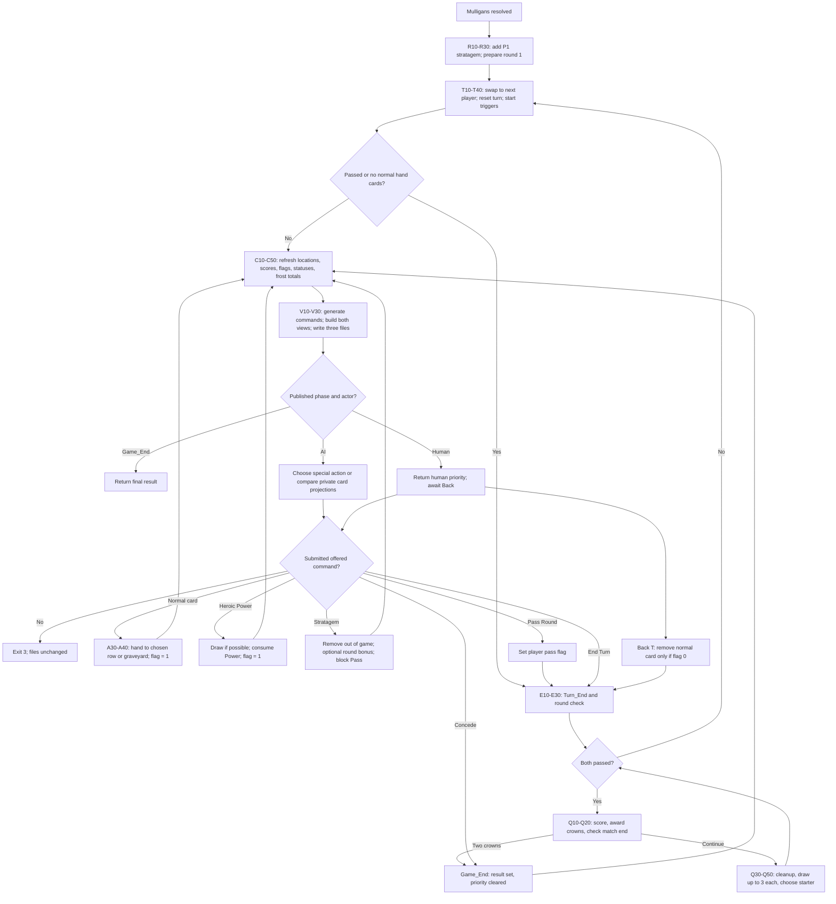

<!-- Modification 2026-10-07: Automatic AI now implemented; updated human-only input, prediction privacy and counter documentation. -->

<!-- Modification 2026-10-07: Updated implemented Power/Stratagem commands, board-bonus scoring and public counts. -->

<!-- Modification 2026-09-29: Documented user-approved three-digit targeting; runtime behavior unchanged. -->

<!-- Modification 2026-09-27: User approved keeping Last_Command exclusively in XXM; updated player-view documentation. -->

<!-- Modification 2026-09-27: Added implemented turn flow, stable insertion points, command layout, frost counters, and error/priority semantics. -->

<!-- Modification 2026-09-27: Implemented pass/AFK/round flow, pseudo-turn bookkeeping, crown-first results and approved Back-only timers/cancellation. -->

# Turn flow — vanilla cards

Current scope: full vanilla PvP match loop, including mulligans, normal play, End Turn, Concede, passing, automatic empty-hand passing, AFK and round/crown results. Heroic Power, Stratagem and public counts are also implemented. Automatic AI is implemented; other card effects remain future work.

## Confirmed decisions

- Mulligans still accept both human choices together. Single-player priority starts after mulligans.
- A card play retains the same player's priority. End Turn or Concede must follow; there is no automatic end after playing.
- Concede is fully implemented now and awards the opponent the game. Round-based wins and draws are implemented.
- Each player's frost history advances only at that player's own normal or pseudo-turn start. Both increment the global counter and decrement that player's frost duration; actual frost damage is deferred.
- Normal cards are Units, Spells, and Locations played from hand. Heroic Power sets Card_has_been_played and replaces normal play; Stratagem does not.

## Flow



Start/end phases run internally, without asking for input halfway through. Published priority states use `Game_Phase: "Turn"`. `Last_Phases` records the phases traversed by the latest accepted invocation, making the internal `Turn_Start` and `Turn_End` steps observable in all three JSON files.

## Phase order and checks: stable step labels

These labels are shared with the main README and code comments. To request a new check, say, for example, “insert X between T20 and T30” or “insert Y between C30 and C40.” Intermediate labels such as T25 can be added without renumbering existing steps.

| Step | Phase / operation | Implemented behavior |
| --- | --- | --- |
| R10 | After accepted M | Append P1's selected stratagem to P1 hand exactly once, after the ten normal cards |
| R20 | `Round_Start` | Set round 1 and turn counter 0 |
| R30 | Before first turn | Seed active/opponent as 2/1 so the common swap chooses P1 |
| T10 | `Turn_Start` | Swap active/opponent; increment the global `Turn_number` |
| T20 | `Turn_Start` | Reset Card_has_been_played and Stratagem_has_been_played to 0; shift only the active player's frost window and clear its newest bucket |
| T30 | `Turn_Start` | Decrement own frost durations; actual damage/effect handlers remain reserved |
| T35 | `Turn_Start` processing | Empty normal hand sets passed; stratagem does not count |
| T40 | `Turn` | For passed players, continue automatically through E10; otherwise C10–V30 |
| A10 | Submitted P | Load Motor/view/catalogue files and check phase, priority, and saved-view consistency |
| A20 | Submitted P | Require the exact code in the active player's saved and regenerated legal commands |
| A30 | Normal card play | Remove the card from hand; reserved on-play effect point |
| A40 | Normal card play | Append Unit to selected row; Spell/Location to graveyard; reserved entry effects; set normal-card flag to 1 |
| A42 | Heroic Power | Consume once-game use; draw if deck nonempty; set played flag 1; retain priority |
| A44 | Stratagem | Remove out of game; set Stratagem flag; +5 round bonus if own board contains a unit; retain priority |
| A50 | `Turn` | Keep priority with the same player, then run C10 through V30 |
| A25 | Accepted Pass Round | Set active player's round-pass flag, then E10 |
| F10 | Back timeout T | Validate Turn; flag 0 removes random non-stratagem card, retaining Exist=false/Location=0000; flag 1 removes nothing; then E10 |
| E10 | End Turn, Pass, timeout or pseudo-turn | Enter `Turn_End` |
| E20 | `Turn_End` | Reserved board end-turn effect point |
| E30 | `Turn_End` | Both passed → Q10; otherwise T10 |
| Q10 | `Round_End` | Refresh board totals; award crown(s) to winner or both on tie |
| Q20 | Result check | Any two crowns → Game_End immediately, without cleanup/draw |
| Q30 | Continuing match | Board units to graveyard/base strength; clear frost state, retain history/unused stratagem |
| Q40 | `Round_Start` | Increment round; draw up to three each; reset pass flags then mark empty normal hands |
| Q50 | Next starter | Previous winner or opposite previous starter on tie; both empty → Q10, otherwise T10 |
| G10 | Accepted Concede | Set `Game_End`, `Winner`, `End_Reason: "Concede"`, clear both active IDs, then run C10 through V30 |
| C10 | Before publication | Check unique card membership; update locations for deck, hand, rows, and graveyard |
| C20 | Before publication | Sum row strengths; board = both rows + Round_Bonus |
| C25 | Before publication | Refresh Hand/Deck/Graveyard counts for both seats |
| C30 | Before publication | Update Roach/Winter Queen deck flags only for the relevant faction; remove irrelevant keys |
| C40 | Before publication | For all card records: `Boosted = current > base`, `Hurt = current < base`; clear both when equal |
| C50 | Before publication | Sum each player's five frost buckets into the existing rolling total |
| V10 | Before publication | Generate fresh legal commands for each player; save both lists in XXM |
| V20 | Before publication | Rebuild XX1/XX2 from templates with current state and commands, excluding private Last_Command |
| V30 | Before returning status | Serialize all documents, write XXM/XX1/XX2, then return the status to Back |
| V40 | Automatic AI gate | If AI has priority, continue N10; otherwise return human priority or final result |
| N10 | AI decision | Capture turn-start margin once; try Stratagem, Power, then End/Pass |
| N20 | AI normal play | Clear own generated predictions; independently simulate each legal normal command and rank refreshed margins |
| N30 | AI apply | Apply chosen command through A10–A50/E/Q as appropriate, publish C10–V40 and repeat if still AI |

`start_turn` refuses to swap if the phase is already `Round_End` or `Game_End`. Round transitions establish Round_Start and seed the approved next starter before using this path. No extra swap happens when a player plays a card or merely receives an updated view.

## State additions

`Card_has_been_played` is numeric `0` or `1`. It starts at 0, becomes 1 after a Unit/Spell/Location play from hand or Heroic Power, and resets at each turn start. It is retained by initialization: card-record operations check numeric IDs, so the `Card_` prefix in this flag does not cause it to be deleted or treated as a card dictionary.

`Turn_number` is a global turn count: P1's first turn is 1, P2's first turn is 2, P1's next turn is 3. The counter continues across rounds and includes automatic pseudo-turns. `Round_number` advances after a nonfinal round.

The ten new fields are `Player_1_Frost_Damage_Turn_1` through `_5`, and the equivalent five for Player 2. Each begins at zero. Bucket 1 is damage in the player's current/latest own turn; 2 is its preceding own turn, through 5. At that player's turn start: discard bucket 5, shift 4→5, 3→4, 2→3, 1→2, and clear 1. The other player's buckets stay unchanged. Future frost handlers add damage to bucket 1 after the shift; no frost damage is applied yet. The existing `Frost Dmg on last 5 turns P1/P2` values are always recomputed as the sums.

P1's hand contains 11 entries after mulligans: ten normal cards and stratagem 126 or 152. The stratagem location becomes `1211` initially. It uses action 3 with destination 5, but is removed out of game. With an own-board unit, add 5 to the round board bonus; otherwise no effect. A hand containing only the stratagem has no normal-card plays.

For Witcher, keep `Player N Roach in Deck` and omit `Player N Winter Queen in Deck`; for Wild Hunt, do the reverse. The source template may contain both; emitted XXM only keeps the faction-relevant flags.

## Available commands

Mulligan formats are unchanged. Ordinary commands currently preserve the original 14-digit fields with no targets or placement positions:

```text
P A CCC ZNN Z00 000
```

Spaces above are explanatory only; actual codes are continuous strings.

| Field | Meaning |
| --- | --- |
| P | Absolute player 1 or 2 |
| A | 0 Pass Round; 1 Concede; 2 Heroic Power; 3 Play card/Stratagem; 6 End Turn |
| CCC | Full card ID, or 000 for Pass/Concede/End Turn |
| ZNN | Source zone and hand position; zone 2 for a hand play; 000 for control actions |
| Z00 | Destination row 3/4, or graveyard 5 for Spell/Location; placement position always 00 |
| 000 | Unused target; zero in every current command |

Example, if card 101 is in P1's hand position 01:

| Action | Code |
| --- | --- |
| Play 101 to front row | `13101201300000` |
| Play 101 to back row | `13101201400000` |
| P1 Pass Round | `10000000000000` |
| P2 Pass Round | `20000000000000` |
| P1 End Turn | `16000000000000` |
| P1 Concede | `11000000000000` |
| P2 End Turn | `26000000000000` |
| P2 Concede | `21000000000000` |

Front must use the codes in its current `Available_Commands`, not a hardcoded example. Source positions still identify the hand entry; destination positions have no gameplay meaning. Units append to the row's list and existing card locations stay consistent. The confirmed target-token convention below supersedes the old target-zone/position interpretation; runtime commands still use only 000.

At priority, the active player always has Concede. Before a normal card play, it also has Pass Round, two commands per Unit (front/back) and one per Spell/Location (graveyard). After normal play or Power, it has End Turn, Concede and its remaining Stratagem if any. Before play, unused Power is available; after Stratagem, Pass Round is blocked. The inactive player has no commands, including no concession command until it receives priority. XXM holds `Available_Commands` as an object keyed by `"1"` and `"2"`; each player view holds only its own list.

Back invokes `./motor.py XX P <code>` or `./motor.py XX T`. Result 1/2 identifies the next input player; 61/62 identifies the match winner; 63 is a draw. Game_End clears both active IDs and commands. Winner is 1/2, or 0 for a draw; End_Reason is Concede or Crowns. The final board is preserved. Starter fields in XXM track current and previous round starters independently of priority.

### Confirmed targeting convention — not yet implemented

The final three digits are a target token `TTT`, replacing the original target-zone/position interpretation without increasing the 14-digit command length: `P A CCC ZNN Z00 TTT`. Source and destination fields remain unchanged.

| Target | Player 1 | Player 2 |
| --- | --- | --- |
| Deck | `011` | `021` |
| Hand | `012` | `022` |
| Front row | `013` | `023` |
| Back row | `014` | `024` |
| Graveyard | `015` | `025` |
| Player / terrain | `016` | `026` |

- `000` means no target.
- An existing full card-instance ID (`101–152` or `201–252`) targets that specific card, not its position. Different copies have distinct IDs; only existing, eligible instances may be offered.
- Zone/player targets use `0 | absolute player | zone`. Player 1/2 never means self/opponent. A terrain corresponds to its player; the effect determines what it affects there. Zone 6 follows the manual README's player designation; it is not a card-containing list in the current state.
- `010`, `020` and other unlisted zero-prefixed values are unassigned. Out-of-game/nowhere is not an eligible zone target in this convention. Relative side codes 6/7 are not used as side fields.
- A card target identifies one instance; a zone target identifies the zone itself. Card metadata and effect rules must determine eligible targets without revealing hidden hand/deck identities.
- This defines one target per command. Multiple targets, later choices after new information, and the exact role of action 4 still need discussion before implementation.

Only `000` is currently generated. Nonzero targets remain unsupported and must not be submitted. This documentation approval does not authorize implementation: notify the user before changing code. No card effects, catalogue data, source positions, destination semantics or state locations have been changed.

## Last command and privacy

XXM records `Last_Command` as `I ...`, `M ...`, `P ...`, or `T`. This field is private to XXM and is never included in either player view, regardless of the operation. No failed request replaces the stored last command. The player templates also expose the normal-card flag, turn number, phase trace and concession result, while continuing to hide deck order and opponent hand identities.

## Errors and current limits

| Situation | Motor behavior |
| --- | --- |
| Inactive player submits a command | Exit 3; no room writes |
| End Turn before a normal card play | Not offered; exit 3 if submitted |
| Second normal card in same turn | Not offered; exit 3 if submitted |
| Attempt to choose an exact placement position or nonzero target | Not offered; exit 3 |
| Power after normal play, second Power, or Pass Round after Stratagem | Not offered; exit 3 |
| Submitted code absent from the current active player's offers | Exit 3; preserve all three files |
| Missing/corrupt state, bad catalogue type, inconsistent saved view/offer list | Exit 4; Back cancels under the current policy |
| P or T after Game_End | Exit 3; final files unchanged |
| Pass after normal play | Not offered; exit 3 |
| T during mulligans | Exit 3; Back supplies zero-return M code for the timed-out seat |
| No normal cards at turn start | Automatically passed; effect-only phases without input |
| AI has turn priority | Motor executes it internally; external AI P/T is rejected, no human input or AI timer |

Back authenticates player identity and serializes room operations. No automatic defeat is assigned for invalid inputs. Matching numeric codes cannot distinguish every replay from an older state/match; Back alone owns timer identity and stale-event rejection for now; Motor-side revision/match identifiers remain deferred. Writes are sequential rather than transactional: if output writing fails, Back must discard the update and cancel, even if one file was already replaced.

Existing initialized Mulligan rooms acquire the new counters on successful M. Old post-mulligan rooms lacking starter fields or current generated offers should be reinitialized explicitly with I; no saved room is silently rewritten during installation of this change.

## Verification

Run `PYTHONDONTWRITEBYTECODE=1 python3 -m unittest discover -s motor -p 'test_*.py' -v` from the project root. The suite covers initialization, mulligans, normal turns, passing, AFK before/after play, owner-only pseudo-turn history/duration, round draws/cleanup, complete 2–0/2–1/2–2 matches, crown checks before cleanup, final rejection, room isolation and interrupted saving. Test rooms are temporary.

## Power and Stratagem integration

Heroic Power: P1 `12000000000000`, P2 `22000000000000`, used through P. Available once per game before normal play, even with empty deck; draws at most one and replaces normal play. `Player_N_Power_Used` is public. Stratagem can accompany the normal card or Power, before or after; alone it blocks Pass Round but does not enable End Turn or avoid the AFK penalty.

Stratagem uses its offered spell-style action 3 code, is removed out of game, and adds +5 to Board_Strength for this round only when an own-board unit exists at activation. It does not boost any individual card or row. **Use published Board_Strength; it may exceed the sum of row strengths by 5.** Final score retains the bonus; continuing rounds reset it.

Both views and XXM contain Player_N_Hand_Count, Player_N_Deck_Count, Player_N_Graveyard_Count and Player_N_Power_Used for N=1/2. Hand count includes Stratagem; empty-hand passing still excludes it. Last_Command remains private. AI is now automatic after the completed backup checkpoint; no AI input is requested from Front.

## Automatic AI integration

Back initializes at most one AI seat, still Witcher: `./motor.py 07 I P11 I21` (human P1), or `./motor.py 07 I I11 P22` (human P2). Then send only the human's offered mulligan code: `./motor.py 07 M 15000000000` or `./motor.py 07 M 25000000`, respectively.

Motor resolves AI choices after M and whenever human P/T hands it priority. It publishes every accepted real action and continues until human input or Game_End. Back must wait for the process to finish and forward the final private player view. Do not watch intermediate writes as an animation stream or request an AI timer. Codes 1/2 identify the human; 61/62/63 are final results.

Private generated files are `motor/ai_prediction/XX/<command>.json`. They contain full Motor-state predictions and must never reach Front. They are refreshed only for card evaluation; special actions do not create candidate files. Current selection simulates Units, Spells and Locations, preferring margins +1, 0, -1, +2, -2, … . Special action priority is Stratagem, then eligible Power, then pass/end as applicable.

Private XXM counters `Player_N_Completed_Turns_This_Round` count completed playable turns (End Turn/Pass/AFK), reset each round, and exclude pseudo-turns. AI uses them for first-playable-turn Power in rounds 2/3 and the opponent-completed-turn condition in round 1. They are not player-view fields. See the [full AI rules](Motor-rm-GPT_formatted.md#ai--implemented-7-october-2026) for exact conditions.
